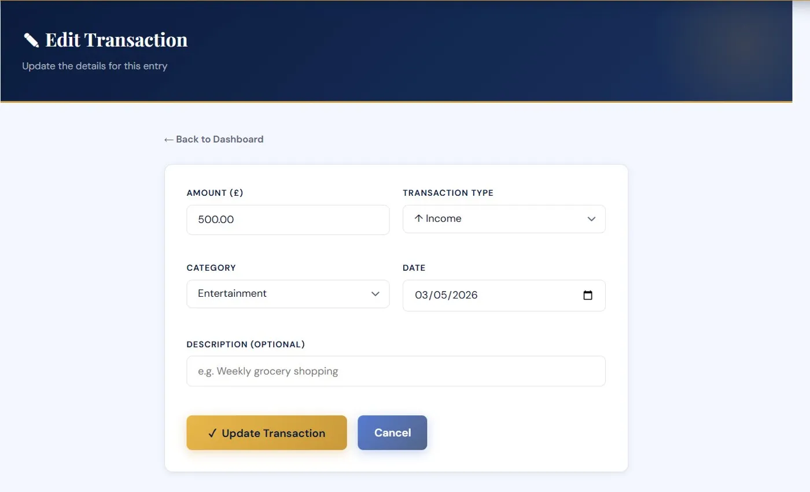
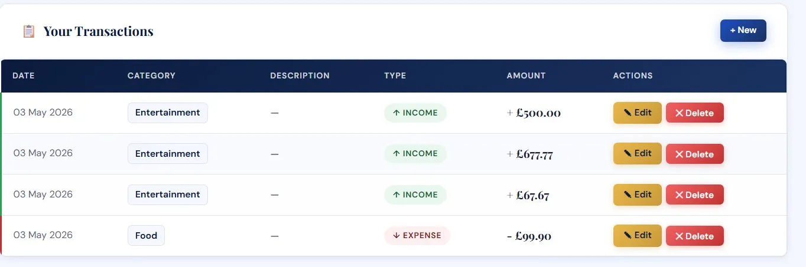
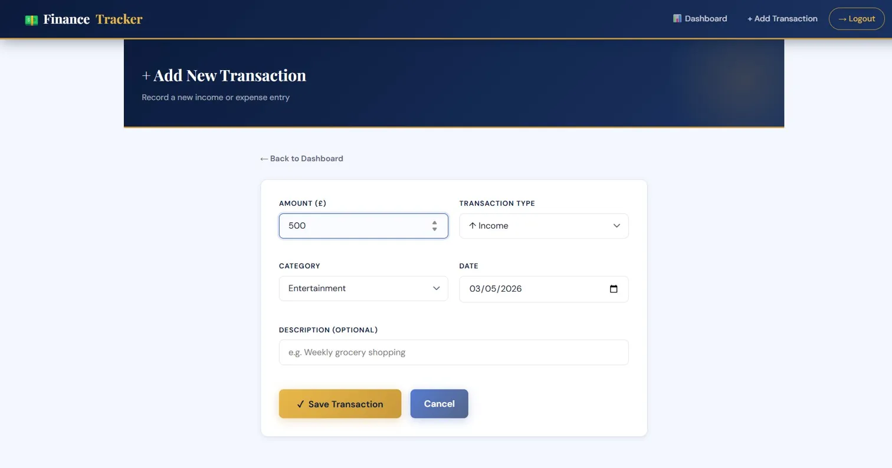
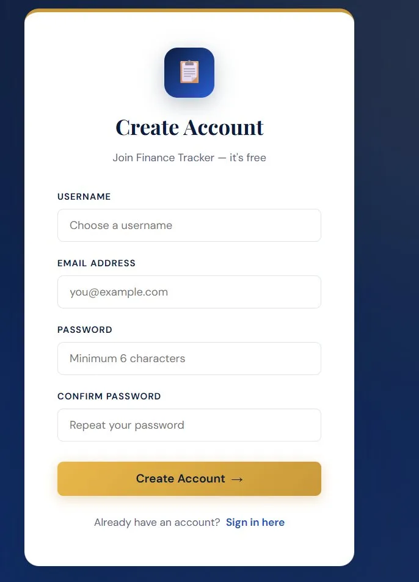

# Finance Tracker

A full-stack personal finance web app built with **PHP**, **MySQL**, **HTML**, **CSS** and **JavaScript**. Users register, log in and manage their own income and expenses, with a dashboard that totals everything automatically.

## Screenshots

## Features

- Register and log in; passwords are hashed with bcrypt (`password_hash`) and never stored in plain text
- Add, edit and delete transactions (income or expense) with a category, date and description
- Dashboard showing total income, total expenses and balance
- Each user only ever sees and changes their own transactions
- Validation with clear error messages, and output escaped to prevent XSS

## Tech

| Part | Technology |
|---|---|
| Back end | PHP (mysqli) |
| Database | MySQL, managed in phpMyAdmin |
| Front end | HTML, CSS, JavaScript |

## Setup (XAMPP)

1. Copy this folder into `C:\xampp\htdocs\` and name it `finance_tracker`.
2. Open the **XAMPP Control Panel** and start **Apache** and **MySQL**.
3. Open phpMyAdmin at http://localhost/phpmyadmin, go to the **SQL** tab, paste in the contents of `database.sql` and run it.
4. Visit http://localhost/finance_tracker and click **Create one here** to register.

If your folder has a different name, change `BASE_URL` in `includes/config.php`. If your MySQL has a password, set it in `includes/db.php` (XAMPP's default is none).

## Project structure

| Path | Purpose |
|---|---|
| `index.php`, `login.php` | Entry point and sign-in page |
| `includes/` | Database connection, sessions and login checks, shared header and footer, config |
| `pages/` | Register, dashboard, add, edit, delete and logout |
| `public/` | Stylesheet and JavaScript |
| `database.sql` | Database structure and starting categories |

## Database

Three tables: `users`, `categories` and `transactions`. Every transaction belongs to a user through a foreign key, and deleting a user removes their transactions.

## Author

Khushwant Kumar, BSc Computer Science student at Aston University. Released under the MIT licence.
